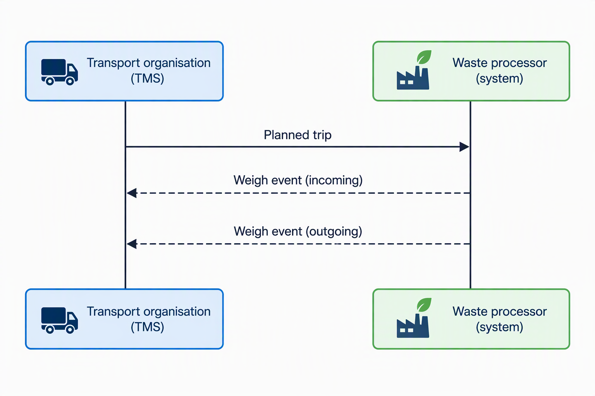

# OTM Profile - EBA Waste Disposal

:::warning
This profile is still a work in progress.
:::

:::info
The message models of OTM profiles are specified and maintained here: https://sutc.semantic-treehouse.nl/specifications

Direct link to the DRAFT versions OTM Profile - EBA Waste Disposal: [Planned Trip](https://sutc.semantic-treehouse.nl/message-model/MessageModelSpec_3bb94298-2b5e-4538-b5ba-cb5245e82d13) & [Weigh event](https://sutc.semantic-treehouse.nl/message-model/MessageModelSpec_d9fe8d1d-bf70-4d88-8fb0-724b936c8201)
:::


## Introduction / context

The EBA Waste Disposal profile supports the exchange of transport and weighing information between a transport organisation and a waste processor during the disposal of waste. This is a requirement from the **European Banking Authority** who governs the waste disposal under EU regulation.

The profile enables the Transport Management System (TMS) of the transport organisation to provide information about a planned waste transport to the waste processor. During the disposal process, the waste processor provides weighing information back to the transport organisation.

## Scope OTM Profile

The EBA Waste Disposal profile covers the exchange of information required to support the standard waste disposal process between a transport organisation and a waste processor.

The standard flow consists of three main exchanges:

1. **Planned trip:** Before the transport takes place, the TMS of the transport organisation sends a planned trip message to the waste processor's system. The message describes the planned transport and contains information about the waste being transported, such as the applicable waste types.

2. **Incoming weigh event:** When the vehicle arrives at the waste processor and passes the weigh station, the waste processor's system sends an incoming weigh event to the TMS. This event contains the measured total weight of the transport combination, including the vehicle and its load.

3. **Outgoing weigh event:** After the waste has been unloaded, the vehicle passes the weigh station again. The waste processor's system sends an outgoing weigh event to the TMS containing the measured weight after unloading. This weight can be either entered manually, per weigh station or through tare weight.

The difference between the incoming and outgoing weighing results can be used to determine the weight of the waste that has been unloaded.



## Foundation for EBA Waste Disposal profile

The EBA Waste Disposal profiles are a replacement of the current UBL-based v1.2 transport document and weigh confirmation (NL: Weegbevestiging) messages. 

This was done to better align with the development of the Open Trip Model and move from the Universal Business Language (UBL) to the OTM v5.9. The mapping from the decrepated UBL documents to the new OTM-based messages can be found in [transport document mapping](https://sutc.semantic-treehouse.nl/mapping-spec/MappingSpec_8717b261-a0fa-4f19-8012-8456ff64e35f) and [weigh confirmation mapping](https://sutc.semantic-treehouse.nl/mapping-spec/MappingSpec_6e272a5a-b62f-46d1-8525-a39cb6ec9d3f)

## OTM Profile Structure

The full message specification can be found in the SUTC [Semantic Treehouse Environment](https://sutc.semantic-treehouse.nl/).

The **Planned Trip (EBA)** message is build around the OTM `Trip` element. This container allows `vehicle`, `actors` and `actions` be communicated. To specify the type of waste that is being disposed off, the `classificationLines` element within the `goods/entity` element can be used. The classification lines allows the TMS to communicate the EURAL code of the waste. 

The **Weigh Event (EBA)** message has the root element of `weighEvent`. In this element, the sub-elements of `vehicle` and `weighingResult` can be communicated. When weighing the allowed `weighingType` are:
* calibrated - Measurement from the calibrated weighing equipment of the waste processor;
* manual - Data entered manually from the chauffeur; or
* tare - Weight from the known specifications of the empty vehicle.

The manual and tare options are only available for the outgoing weigh event message. 

## Example
The shape of these messegas are straightforward.
### Planned Trip (EBA)
```json
{
    "entityType": "trip",
    "id": "b36fa58d-569a-49e3-bcaa-ebacb1120a35",
    "externalAttributes": {},
    "status": "confirmed",
    "vehicle": {
        "associationType": "inline",
        "entity": {
            "id": "f374b805-dd8a-4ecc-a542-9776bc748fd5",
            "licensePlate": "BB-01-BB"
        }
    },
    "actors": [
        {
            "associationType": "inline",
            "entity": {
                "id": "5afca73b-77bd-4947-a056-aafae0c27b23",
                "name": "Example Logistics B.V."
            },
            "roles": [
                "shipper"
            ]
        }
    ],
    "actions": [
        {
            "associationType": "inline",
            "entity": {
                "actionType": "stop",
                "location": {
                    "associationType": "inline",
                    "entity": {
                        "id": "93a71809-fb31-482f-a40d-d1cf856842cf",
                        "geoReference": {
                            "type": "addressGeoReference",
                            "name": "Example Waste Processing Facility",
                            "street": "Industrieweg",
                            "houseNumber": "25",
                            "houseNumberAddition": "",
                            "postalCode": "7418 AA",
                            "city": "Deventer",
                            "country": "NL"
                        },
                        "gln": "8712345678906"
                    }
                },
                "startTime": "2026-11-06T10:00:00+01:00",
                "endTime": "2026-11-06T10:30:00+01:00",
                "actions": [
                    {
                        "associationType": "inline",
                        "entity": {
                            "actionType": "unload",
                            "consignment": {
                                "associationType": "inline",
                                "entity": {
                                    "goods": [
                                        {
                                            "associationType": "inline",
                                            "entity": {
                                                "entityType": "goods",
                                                "type": "items",
                                                "id": "db9f02c3-6944-4781-b1a0-9390623387d6",
                                                "name": "Mixed construction and demolition waste",
                                                "quantity": 1,
                                                "weight": {
                                                    "value": 12450,
                                                    "unit": "kg"
                                                },
                                                "adr": {
                                                    "UNNumber": "UN3077",
                                                    "waste": true,
                                                    "description": "Environmentally hazardous substance, solid, n.o.s."
                                                },
                                                "classificationLines": [
                                                    {
                                                        "euralCode": "170904"
                                                    }
                                                ]
                                            }
                                        }
                                    ]
                                }
                            },
                            "transportEquipment": {
                                "associationType": "inline",
                                "entity": {
                                    "id": "3d426a7f-603d-4570-925b-89b010447f1b",
                                    "equipmentType": "trailer",
                                    "licensePlate": "OP-12-AB"
                                }
                            }
                        }
                    }
                ]
            }
        }
    ]
}

```

### Weight Event (EBA)
```json
{
    "eventType": "weighEvent",
    "id": "0264c464-e973-4ef8-a272-6a6dff716cbf",
    "creationDate": "2026-11-06T10:12:43+01:00",
    "vehicle": {
        "associationType": "inline",
        "entity": {
            "licensePlate": "BB-01-BB"
        }
    },
    "weighingResult": {
        "weighingType": "calibrated",
        "weight": {
            "value": 28740,
            "unit": "kg"
        },
        "remark": "Incoming weighing before unloading",
        "weighbridgeId": "WB-01",
        "weighbridgeSequenceNr": "2026-004582"
    }
}
```
