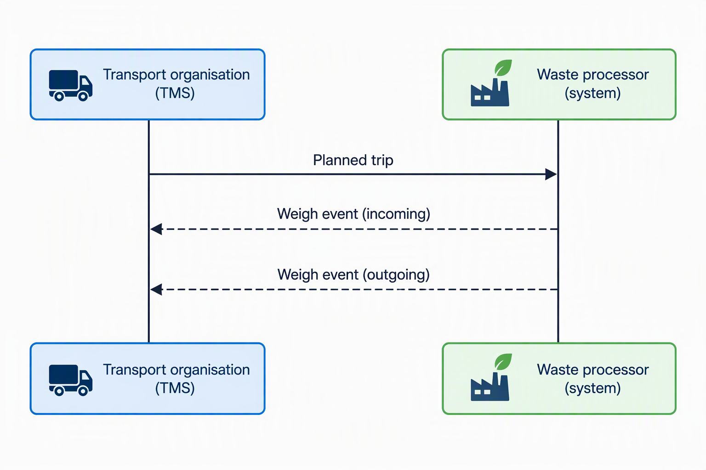

# OTM Profile - Waste transport

:::warning
This profile is work in progress.
:::

:::info

The message models of OTM profiles are specified and maintained here: [SUTC specifications](https://sutc.semantic-treehouse.nl/specifications)

An overview of the specifications for the OTM profile for waste transport can be found here: [OTM profile - Waste transport](https://sutc.semantic-treehouse.nl/project/otm-profile-waste-transport)

The profile consists of two message models:
1. [Planned Trip](https://sutc.semantic-treehouse.nl/id/specification/otm-profile-eba-planned-trip)
2. [Weigh event](https://sutc.semantic-treehouse.nl/id/specification/otm-profile-eba-weigh-event)

:::


## Introduction / context

The OTM profile for waste transport supports the exchange of transport and weighing information between a transport organisation and a waste processor.

This profile covers the same functionality as the outdated [Elektronische Begeleidingsbrief Afval (EBA) standard](https://sutc.semantic-treehouse.nl/id/project/elektronische-begeleidingsbrief-afval) version 1.2. That standard is based on UBL/XML, whereas the OTM profile is based on OTM JSON. Mapping specifications are available to support the transition from EBA v1.2 to OTM profile for waste transport (see section below).

## Scope OTM Profile

The profile enables the Transport Management System (TMS) of the transport organisation to provide information about a planned waste transport to the waste processor. The waste processor provides weighing information back to the transport organisation.

The standard flow consists of three main exchanges:

1. **Planned trip:** Before the transport takes place, the transport organisation's TMS sends a planned trip message to the waste processor's system. The message describes the planned transport and includes information about the waste being transported, such as the applicable waste types. Furthermore, status changes and updated information about the planned trip can be sent to the waste processor's system.

2. **Weigh event 1:** When the vehicle arrives at the waste processor and passes the weigh station, the waste processor's system sends a weigh event to the TMS. This event contains the measured total weight of the transport combination, including the vehicle and its load.

3. **Weigh event 2:** After the waste has been unloaded, the vehicle passes the weigh station again. The waste processor's system sends another weigh event to the TMS containing the measured weight after unloading.

Weighing results can be of type calibrated, manual or tare.

The difference between the incoming and outgoing weighing results can be used to determine the weight of the waste that has been unloaded.




## OTM Profile Structure

The full message specification can be found in the SUTC [Semantic Treehouse Environment](https://sutc.semantic-treehouse.nl/).

The **Planned trip** message is built around the OTM `Trip` element. This allows information about `vehicle`, `actors` and `actions` to be communicated. To specify the type of waste that is being disposed of, the `classificationLines` element within the `goods/entity` element can be used. The classification lines allow the TMS to communicate the EURAL code of the waste. 

The **Weigh event** message has the root element of `weighEvent`. In this element, the sub-elements of `vehicle` and `weighingResult` can be communicated. The allowed values for `weighingType` are:
* calibrated - Measurement from the calibrated weighing equipment of the waste processor;
* manual - Data entered manually by the driver; or
* tare - Weight from the known specifications of the empty vehicle.

## Updates of planned trip

Updates to a planned trip follow the regular OTM mechanisms; no profile-specific messages are needed:

* **Updating information** - When planned information changes (e.g. another vehicle, time window or waste type), the TMS sends the complete, updated trip using the `PUT` endpoint of the OTM API for trips, with the same trip `id`. The waste processor's system replaces its previous version of the trip with the received one. See the [API specification](../developers/api_specification.md).
* **Status changes** - The progress of the trip is communicated through its `status` (e.g. `confirmed`, `inTransit`, `completed`). A planned trip that will not take place is set to `cancelled`. The meaning of the status values and allowed transitions are explained in [Entity status](../fundamentals/entity_status.md).

## Examples

### Planned trip
```json
{
    "entityType": "trip",
    "id": "b36fa58d-569a-49e3-bcaa-ebacb1120a35",
    "externalAttributes": {},
    "status": "confirmed",
    "vehicle": {
        "associationType": "inline",
        "entity": {
            "id": "f374b805-dd8a-4ecc-a542-9776bc748fd5",
            "licensePlate": "BB-01-BB"
        }
    },
    "actors": [
        {
            "associationType": "inline",
            "entity": {
                "id": "5afca73b-77bd-4947-a056-aafae0c27b23",
                "name": "Example Logistics B.V."
            },
            "roles": [
                "shipper"
            ]
        }
    ],
    "actions": [
        {
            "associationType": "inline",
            "entity": {
                "id": "7c1e2b4a-3f5d-4e8a-9b6c-1d2e3f4a5b6c",
                "actionType": "stop",
                "location": {
                    "associationType": "inline",
                    "entity": {
                        "id": "93a71809-fb31-482f-a40d-d1cf856842cf",
                        "geoReference": {
                            "type": "addressGeoReference",
                            "name": "Example Waste Processing Facility",
                            "street": "Industrieweg",
                            "houseNumber": "25",
                            "postalCode": "7418 AA",
                            "city": "Deventer",
                            "country": "NL"
                        },
                        "gln": "8712345678906"
                    }
                },
                "startTime": "2026-11-06T10:00:00+01:00",
                "endTime": "2026-11-06T10:30:00+01:00",
                "actions": [
                    {
                        "associationType": "inline",
                        "entity": {
                            "id": "e4f5a6b7-c8d9-4e0f-a1b2-c3d4e5f6a7b8",
                            "actionType": "unload",
                            "consignment": {
                                "associationType": "inline",
                                "entity": {
                                    "goods": [
                                        {
                                            "associationType": "inline",
                                            "entity": {
                                                "entityType": "goods",
                                                "type": "items",
                                                "id": "db9f02c3-6944-4781-b1a0-9390623387d6",
                                                "name": "Mixed construction and demolition waste containing hazardous substances",
                                                "quantity": 1,
                                                "weight": {
                                                    "value": 12450,
                                                    "unit": "kg"
                                                },
                                                "adr": {
                                                    "UNNumber": "UN3077",
                                                    "waste": true,
                                                    "description": "Environmentally hazardous substance, solid, n.o.s."
                                                },
                                                "classificationLines": [
                                                    {
                                                        "euralCode": "170903*"
                                                    }
                                                ]
                                            }
                                        }
                                    ]
                                }
                            },
                            "transportEquipment": {
                                "associationType": "inline",
                                "entity": {
                                    "id": "3d426a7f-603d-4570-925b-89b010447f1b",
                                    "equipmentType": "trailer",
                                    "licensePlate": "OP-12-AB"
                                }
                            }
                        }
                    }
                ]
            }
        }
    ]
}

```

### Weigh event (incoming)
```json
{
    "eventType": "weighEvent",
    "id": "0264c464-e973-4ef8-a272-6a6dff716cbf",
    "creationDate": "2026-11-06T10:12:43+01:00",
    "vehicle": {
        "associationType": "inline",
        "entity": {
            "licensePlate": "BB-01-BB"
        }
    },
    "weighingResult": {
        "weighingType": "calibrated",
        "weight": {
            "value": 28740,
            "unit": "kg"
        },
        "remark": "Incoming weighing before unloading",
        "weighbridgeId": "WB-01",
        "weighbridgeSequenceNr": "2026-004582"
    }
}
```

### Weigh event (outgoing)
```json
{
    "eventType": "weighEvent",
    "id": "a8d3c2e1-5b47-4f6a-8c9d-0e1f2a3b4c5d",
    "creationDate": "2026-11-06T10:27:19+01:00",
    "vehicle": {
        "associationType": "inline",
        "entity": {
            "licensePlate": "BB-01-BB"
        }
    },
    "weighingResult": {
        "weighingType": "tare",
        "weight": {
            "value": 16290,
            "unit": "kg"
        },
        "remark": "Outgoing weighing after unloading",
        "weighbridgeId": "WB-01",
        "weighbridgeSequenceNr": "2026-004583"
    }
}
```

The net weight of the unloaded waste in this example is 28740 kg - 16290 kg = 12450 kg.

## Migrating from EBA v1.2 to OTM profile

Organisations that already have an implementation of EBA v1.2 do not have to start from scratch. Mapping specifications are available that describe, element by element, how the EBA v1.2 messages relate to the messages of the OTM profile for waste transport:

| EBA v1.2 message | OTM profile message | Mapping specification |
|---|---|---|
| Vooraanmelding (pre-notification) | Planned Trip | [EBA Vooraanmelding to OTM Trip](https://sutc.semantic-treehouse.nl/id/specification/eba-vooraanmelding-to-otm-trip) |
| Weegbevestiging (weighing confirmation) | Weigh Event | [EBA Weegbevestiging to OTM Event](https://sutc.semantic-treehouse.nl/id/specification/eba-weegbevestiging-to-otm-event) |

These mappings can be used to reuse existing data sources and business logic, and to (temporarily) translate between both formats while trading partners migrate.

### Conceptual differences

Although the functional scope is the same, the OTM profile is based on a different modelling approach than EBA v1.2. Keep the following differences in mind when migrating:

* **Syntax: UBL/XML vs. OTM JSON** - EBA v1.2 messages are XML documents based on UBL. The OTM profile uses JSON messages based on the OTM data model, which can be exchanged via the [OTM API](../developers/api_specification.md).
* **Document-oriented vs. entity-oriented** - An EBA message is a self-contained business document. OTM is built around [entities](../fundamentals/entities.md) (such as trips, actors, locations, vehicles and goods) that each have their own identifier and can be linked to each other using [associations](../fundamentals/associations.md). Entities can be included inline or referenced by `id`.
* **Trip as central concept** - Instead of a pre-notification document, the transport is described as an OTM `Trip` consisting of `actions`. The visit to the waste processor is modelled as a `stop` action with a `location`, a time window, and a nested `unload` action that carries the consignment and goods.
* **Parties as actors with roles** - Parties in EBA are represented as `actors` in OTM, where the function of each party is expressed using `roles` (e.g. `shipper`).
* **Waste classification** - The waste type (EURAL code) is specified on the goods using `classificationLines`, while hazardous substance information is captured in the `adr` element.
* **Status and updates** - Changes to a planned transport are communicated by updating the same trip (same `id`) instead of sending a new document. See [Updates of planned trip](#updates-of-planned-trip).
* **Weighing as an event** - A weighing confirmation is modelled as an OTM `weighEvent`: an occurrence at a specific moment in time, linked to the vehicle, with a `weighingResult` that explicitly states the `weighingType` (calibrated, manual or tare).